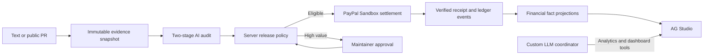

# BountyGuard — Work verified. Rewards released.

## Inspiration and audience

Open-source maintainers and small distributed teams often need to pay for a bugfix or documentation milestone that is too small for a lengthy manual review and payout process. BountyGuard makes the link between work evidence, approval policy, and payment visible and repeatable.

## What it does

Maintainers define immutable acceptance criteria and fund USD rewards through PayPal Sandbox Checkout. Contributors submit pasted evidence or a public GitHub PR. GitHub snapshots bind the diff and configured CI checks to the submitted head SHA. A two-stage auditor evaluates every criterion, and deterministic server policy decides whether to release, block, or request human approval.

AG Studio turns the financial and audit facts into a configurable analytics workspace. A BountyGuard coordinator delegates to Studio's built-in agents. Its Chat Completions adapter uses the team's own OpenAI-compatible endpoint without depending on Responses API or native provider tool calling.

## Sponsor integrations

- **PayPal:** Sandbox OAuth, Orders v2 create/capture, Payouts, authoritative state retrieval, signed webhook verification, idempotent operation IDs, and item-level settlement receipts.
- **AG Studio:** source relationships, edit/view layouts, cross-filtering, report persistence, native agent harness/delegation, and three source-bound custom widgets: Decision Path, Policy What-if, and Settlement Proof.
- **AI:** separate evidence evaluation and critical review, strict validated verdicts, bounded JSON repair, server-enforced tool allowlists, session ownership, and live-AI budget controls.

## How it is built

Next.js App Router, React, TypeScript, Tailwind, Prisma 7, Neon Postgres, AG Grid Community, AG Studio, the OpenAI SDK configured for a custom endpoint, and PayPal's Sandbox REST APIs.

## What makes it different

The product demonstrates the full journey from work evidence to provider receipt. Its analytics agent can explain and visualize the decision but cannot bypass the payment policy. Source labels distinguish fixtures, live AI, simulations, pending provider operations, and completed payouts.

## Try it

- Hosted app: https://bountyguard.vercel.app
- Source: https://github.com/ralvyathaya/bountyguard
- Public demo: no login, resettable.
- Live-AI judge access: use the separate password in private testing instructions. Financial actions remain disabled.
- Video: add the public YouTube link after recording and upload.

## Limitations and next steps

Sandbox only; no live money, FX conversion, multi-user marketplace, arbitrary URL fetching, or submitted-code execution. CI success is evidence from a configured publisher/workflow, not a guarantee of code correctness. Provider access and Payouts permission are prerequisites for a real sandbox settlement. Simulation is always labelled.

## References and licences

Source code is MIT licensed. Commercial dependencies, including AG Studio, retain their vendor licences. The sponsor's https://github.com/paypaldev/hackathon-paypal-ag-grid-boilerplate informed Studio data/theme/report integration; its Responses-based proxy was replaced by BountyGuard's protected Chat Completions adapter.
